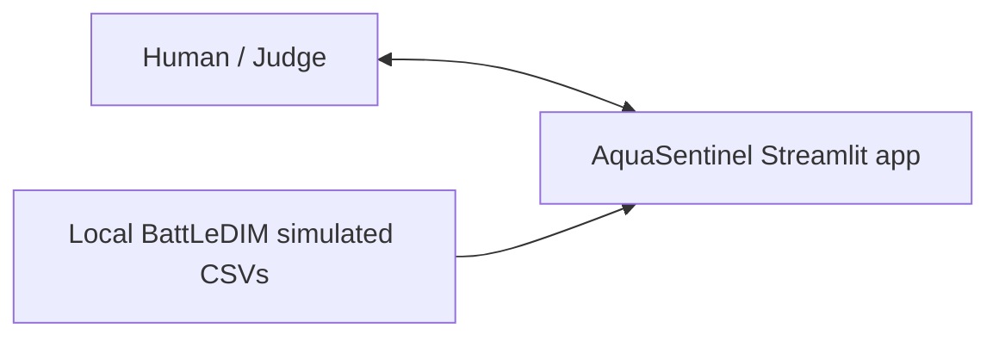
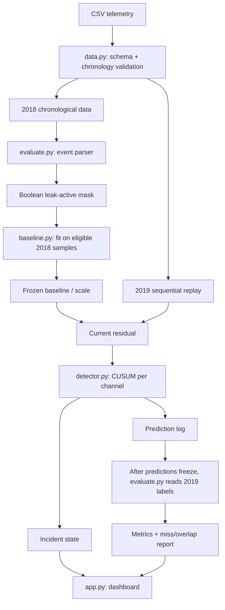

# AquaSentinel — Locked Project Architecture

## Decision
**Pattern:** single-process modular Python application using Streamlit.  
**Pipeline:** validated telemetry → historical baseline → sequential replay → channel-aware CUSUM → incident grouping → post-run evaluation → dashboard.  
**Decision status:** architecture locked; data/source-dependent settings remain conditional on the first-hour gate.

## System context

## Data and evaluation flow

## Module responsibilities

| File | Owns | Must not |
|---|---|---|
| `data.py` | Load telemetry-only files; inspect actual headers; validate timestamp, interval, units, dtypes, duplicates and missingness. | Guess channel IDs or interpret event truth. |
| `baseline.py` | Fit/query robust time-context profiles and scales; receive a plain 2018 inclusion mask. | Import/read labels or update baseline online during a suspected incident. |
| `detector.py` | Pure, channel-aware CUSUM step; idempotency; per-channel incident state. | Read labels/future rows, claim causal certainty or calibrated probability. |
| `evaluate.py` | Parse event metadata; create the 2018 leak-exclusion mask; post-run matching and metrics. | Tune the final test or modify predictions after reading held-out labels. |
| `app.py` | Streamlit UI, replay index/run ID, speed, pause/resume/reset, bounded chart buffer, evidence display. | Update the same observation twice or display hardcoded metrics. |

These are logical modules within one process. Keep the detector pure/testable; no services are required for the MVP.

## Data source and factual boundaries

Primary data: https://zenodo.org/records/4017659  
README: https://zenodo.org/records/4017659/files/README.txt?download=1  
Official challenge: https://battledim.ucy.ac.cy/

The README documents three flow channels (m³/h, link IDs), 33 pressure sensors (m, node IDs), one tank level (m), and 82 AMR demand meters (L/h). Verify actual downloaded filenames, headers, ID mappings, time semantics, and event metadata. Do not hardcode `p227`, `p235`, `PUMP_1`, `n549`, or any zone before verification.

`2018_Leakages.csv`/`2019_Leakages.csv` are leakage time-series data by link; do not assume they are a tidy event table. Inspect `dataset_configuration.yaml` for event start/end/peak metadata and cross-check against the first non-zero leakage series. The fixed-leakage report describes repair times, not onset. Do not treat per-link leak flow as identical to aggregate sensor residual.

The README does not establish a universal timezone convention. Parse strictly and document the source semantics; only normalize timezones if it does not shift the simulated clock.

## Baseline and split protocol

1. Use an early chronological part of 2018 to compare baseline choices and fit candidate profiles, excluding known leak-active samples where reliable metadata permits.
2. Use later 2018 validation to select baseline type, channel direction, CUSUM `k`/`h`, scale fallback, recovery/cooldown, event matching and channel selection.
3. Freeze hyperparameters and matching rules.
4. Refit the chosen baseline/scale using all eligible leak-masked 2018 observations under the same procedure and freeze it.
5. Run 2019 sequentially, generating predictions with no held-out labels in the detector.
6. Only after prediction log finalization should 2019 labels be read for metrics.

The 2019 labels are public; this is a procedurally held-out test, not a blind test. Measure 2018-to-2019 residual drift and report it.

## Baseline and CUSUM

Candidate baseline: day-of-week + time-of-day robust median profile; MAD-derived scale. Compare it with mean/std on 2018 validation. If local scale is near zero or sample count is too low, use a documented pooled robust scale derived from 2018 training data; if no defensible scale exists, mark the channel/profile unavailable. Do not invent a “physical variance” constant.

For a channel expected to increase:
`z_t = (x_t - baseline_t) / scale_t`
`S_t = max(0, S_(t-1) + z_t - k)`
Alert when `S_t > h`.

For expected decreases, use a mirrored lower-sided residual. Select channel direction from verified mapping and 2018 evidence only. Tune `k`, `h`, scale policy, any score cap, hysteresis and cooldown on 2018 only; empirical false-alarm calibration matters because five-minute residuals may be autocorrelated. No online baseline adaptation in the MVP.

CUSUM detects persistent statistical changes, not the cause. Persistent offsets and legitimate demand changes can also trigger alerts. No calibrated probability unless calibration is performed.

## Incidents and event matching

Per-channel states: `NORMAL`, `SUSPECTED_ACTIVE`, `CLEARED_BY_SIGNAL`, `ACKNOWLEDGED_BY_OPERATOR`. Acknowledge only after human action; signal clearing does not prove repair.

A system incident is the union of time-overlapping per-channel incidents, and must list contributing channels. No per-pipe attribution from aggregate flow channels.

Before the 2019 run, define:
- Strict alert window `W` after configured onset.
- Tail period after event end.
- Incident merge gap/cooldown.
- Strict and lenient matching.
- Unmatched alert definition.

Use verified configuration start/end metadata, cross-checked against leakage series. Delay is not evaluable if onset cannot be verified or an event is already active at series start. For ramping events, optionally report a second predeclared delay from a detectable leak-signal threshold. Report overlapping-event ambiguity and counts as well as percentages.

## Streamlit state safety

Use `@st.fragment(run_every=...)`, `st.session_state`, `parallel=False`. Do not call `st.*` inside the row-processing loop. The UI may process a batch per tick, but every row in the batch must be processed sequentially once.

Minimum state: `run_id`, `is_playing`, `replay_index`, `last_processed_index`, speed/rows per tick, per-channel CUSUM and incident state, full prediction log, bounded chart buffer and end-of-data state. Reject stale `run_id`; reject `index <= last_processed_index`. Reset creates a fresh run ID and fresh state. Keep chart memory bounded; retain the complete prediction log separately. `st.cache_data` is not memory mapping and must not hold mutable per-user detector state.

Official docs:
- https://docs.streamlit.io/develop/api-reference/execution-flow/st.fragment
- https://docs.streamlit.io/develop/tutorials/execution-flow/start-and-stop-fragment-auto-reruns

## Evaluation

Compare static threshold, baseline-only residual threshold and CUSUM on the same frozen full 2019 replay at a comparable, predeclared false-alarm budget.

Required:
- Event-level recall.
- Precision under declared matching.
- Unmatched alerts per simulated network month (show counts).
- Detection delay only with verified onset.
- Recall by leak size/diameter where metadata supports it.
- Missed events and representative failures.
- Runtime per batch.

Report strict and lenient matching for overlap ambiguity. No test tuning on 2019. Optional simulated volume-before-alert is allowed only if mathematically supported and must never be called water saved.

## Required tests

- Actual schema/unit/channel mapping.
- Timestamp order/duplicates/intervals.
- Event metadata/onset cross-check.
- Training mask excludes known leak-active windows.
- Known CUSUM sequence.
- Idempotency and stale run ID.
- Prefix invariance (first N outputs unchanged when future rows appended).
- Batch-versus-stream equality.
- Near-zero scale and low-sample profile.
- Missing data skips update; it is never zero-filled.
- Incident merge/clear/reset.
- Label firewall and delayed 2019 label access.
- Strict/lenient overlap matching.
- Replay reset reproducibility and end-of-data stop.

## First-hour gate and pivot

1. Inspect files and schemas.
2. Parse configuration and cross-check event timing.
3. Check clean 2018 data remaining after mask and overlap/events active at series start.
4. Compare channel residuals around events with normal residual variability.
5. Check sign/direction and drift.
6. Decide flow-first versus a small fixed pressure candidate set using 2018 only.

If no channel has a useful signal, narrow the claim; do not cherry-pick a large event.

## Out of scope

No live SCADA, deployment security claims, exact location, model training, graph models, hydraulic digital twin, automatic control, water saved claims, or production readiness. A future pilot requires authorized read-only utility telemetry, local calibration, verified field labels, shadow-mode evaluation, operator feedback, intermittent-supply validation and utility OT security review.
