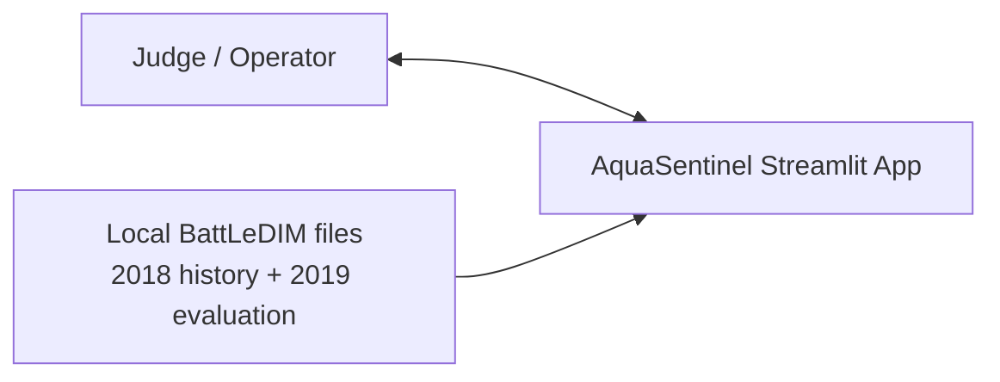
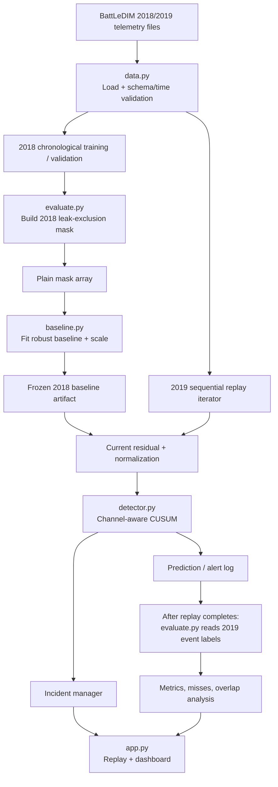

# AquaSentinel — Final Locked Architecture
## Version 3 · Consolidated after Gemini and Claude review

**Architecture decision:** CONDITIONAL PASS — approved for implementation after the first-hour data/detectability gate.  
**Architecture pattern:** Single-process, modular Python application using Streamlit.  
**Core pipeline:** Validated telemetry → robust historical baseline → sequential replay → channel-aware CUSUM → incident grouping → post-run evaluation → dashboard.  
**MVP boundary:** Local BattLeDIM benchmark replay only; no live municipal connection.

---

# 1. Final architecture decision

Build AquaSentinel as a **single-process Streamlit modular monolith** with five logical modules. Keep the detector as ordinary, independently testable Python code. Use Streamlit for replay controls and visualization—not as the place where statistical calculations are mixed into UI code.

### Locked choices

- **UI / replay:** Streamlit `st.fragment(run_every=...)`, with `parallel=False`, plus per-session `st.session_state`.
- **Data handling:** pandas for initial CSV loading and validation; NumPy/Python for numerical calculations.
- **Baseline:** Robust time-of-day/day-of-week profile using median and MAD-derived scale as the primary candidate; compare with mean/standard-deviation on 2018 validation.
- **Detection:** Channel-aware one-sided CUSUM, with per-channel direction chosen from verified metadata and 2018-only evidence.
- **Comparators:** Static threshold and baseline-only residual threshold, evaluated on the same frozen 2019 replay.
- **Evaluation:** Separate label-aware module, with predeclared event-matching rules.
- **Charting:** Plotly or another already-familiar plotting library, selected for reliable updates rather than novelty.
- **Storage:** Local source files and in-memory state. No database is needed for this replay MVP.

### What remains conditional

The **architecture is locked**, but exact sensor IDs, sensor direction, whether flow-first is viable, CUSUM parameters, scale fallback, incident recovery rules, and final evaluation outcomes must be established from the actual files and 2018 validation period. Do not present them as known before those checks.

### Explicitly excluded from the five-hour MVP

FastAPI, a separate frontend process, SQL/NoSQL database, Redis, Kafka/message broker, SSE, `asyncio` orchestration, an LLM/agent in the detection path, HGNN/other graph-model training, a calibrated hydraulic digital twin, exact pipe localization, live SCADA integration, valve/pump control, automatic work-order creation, and autonomous dispatch.

The BattLeDIM L-Town data is a simulated benchmark. Sequential replay can demonstrate live-style processing, but is not live utility telemetry or field validation.

---

# 2. Locked problem and solution

## Problem statement

Municipal water-utility operators struggle to identify developing leaks early because normal changes in water demand, sensor errors, and genuine leak events can produce similar pressure and flow patterns. Fixed thresholds can generate too many alerts, while waiting for stronger evidence can delay investigation. Operators need an explainable monitoring system that identifies suspicious persistent changes in water-network measurements and helps them decide when further investigation is warranted.

Use “network/channel” wording in the MVP. Do not claim zone localization unless the relevant sensor-to-zone mapping has been verified.

## Solution statement

**AquaSentinel is an explainable water-network monitoring platform that processes incoming pressure and flow readings sequentially, compares them with historical operating patterns, detects sustained deviations using statistical change detection, and presents evidence-backed suspected-anomaly alerts with measurable benchmark performance.**

The system identifies statistical patterns that may be consistent with a leak. It does **not** prove that the physical cause is a leak. Use “suspected anomaly” or “suspected leak event,” not “confirmed leak.”

---

# 3. System context and architecture diagram

## C4-style context



## Data, detection, and evaluation flow



### Label boundary

`evaluate.py` is the only label-aware module. During offline baseline preparation, it can create a plain Boolean mask for known leak-active 2018 samples and pass that mask to `baseline.py`. The baseline receives only telemetry plus the mask; it does not import a label parser.

The 2019 evaluator must not load or inspect 2019 labels until the prediction log is finalized. The replay/detector path must never read 2019 labels to determine an alert.

Add an import/firewall test and a runtime test that fails if 2019 labels are accessed before replay completion. The 2019 labels are publicly available, so the test period is *procedurally held out*, not secret or blind.

---

# 4. Minimal code structure

```text
aquasentinel/
├── app.py             # UI, controls, replay orchestration
├── data.py            # Telemetry loading + schema/time validation
├── baseline.py        # Baseline fitting and lookup
├── detector.py        # Pure CUSUM step + incident state
├── evaluate.py        # Label/config parsing, training mask, post-run metrics
├── data/
│   └── README.md      # Acquisition, provenance, license notes
├── tests/
│   ├── test_data.py
│   ├── test_baseline.py
│   ├── test_detector.py
│   ├── test_replay.py
│   └── test_evaluate.py
└── requirements.txt
```

| Module | Responsibility | Must not do |
|---|---|---|
| `data.py` | Load telemetry; inspect real headers; validate timestamps, intervals, types, units and missingness; produce chronologically ordered observations. | Guess sensor IDs or decide whether an event is a leak. |
| `baseline.py` | Fit and query robust expected profiles and channel scales. | Read event labels or automatically re-baseline a suspected event. |
| `detector.py` | Update per-channel CUSUM from the current observation and prior state; return score and threshold status; manage minimal incident state. | Read labels, future rows, or output calibrated probability without calibration. |
| `evaluate.py` | Parse configuration/leakage metadata; make the 2018 exclusion mask; perform post-run event matching and metrics. | Tune the final 2019 run or alter predictions after reading test labels. |
| `app.py` | Start/pause/reset replay; manage per-session state; render bounded plots and evidence cards; call evaluation only at the allowed stage. | Process the same row twice or display hardcoded metrics. |

These are logical modules in one process, not separately deployed services. If time becomes tight, combine files while preserving responsibility boundaries.

---

# 5. Dataset facts and schema discovery

Primary sources:
- BattLeDIM dataset: https://zenodo.org/records/4017659
- BattLeDIM README: https://zenodo.org/records/4017659/files/README.txt?download=1
- Official challenge: https://battledim.ucy.ac.cy/

The README documents:
- 3 flow channels, measured in m³/h and named by link IDs.
- 33 pressure sensors, measured in metres and named by node IDs.
- 1 tank-level sensor, measured in metres.
- 82 AMR demand meters, measured in L/h.
- 2018 historical telemetry, 2019 evaluation telemetry, and separate leakage-related files and configuration.

## Do not hardcode sensor IDs before inspection

Previous reports conflict about sensor identities. Do not hardcode `p227`, `p235`, `PUMP_1`, `n549`, or any zone names just because a report mentions them.

During the first-hour gate, inspect actual headers and corroborate channel mappings against source documentation/configuration. Confirm type, unit, ID, flow direction/sign and event response for each candidate.

## Inspect these files if present in the downloaded record

- `2018_SCADA_Flows.csv`
- `2018_SCADA_Pressures.csv`
- `2018_SCADA_Levels.csv`
- `2018_SCADA_Demands.csv` (optional for MVP)
- `2018_Leakages.csv`
- `2018_Fixed_Leakages_Report.txt`
- `2019_SCADA_Flows.csv`
- `2019_SCADA_Pressures.csv` (if testing pressure channels)
- `2019_Leakages.csv`
- `dataset_configuration.yaml`

Verify the exact file spelling and schema in the downloaded record. `2018_Leakages.csv` / `2019_Leakages.csv` represent leak-flow time series by link; do not assume they alone are a tidy onset-label table. The fixed-leakage report provides repair times and must not be used as a substitute for onset.

Inspect `dataset_configuration.yaml` for event start/end and leak metadata, then cross-check configured start/end times against the first non-zero leak-flow samples. Treat the exact fields and their meanings as **unverified until the file is parsed**. For gradually ramping leaks, report configured start delay and, if defined ahead of time, an additional signal-onset delay. Do not infer exact onset from repair time.

The README does not establish a universal timezone convention. Parse timestamps strictly, check their format and ordering, and document one consistent internal convention. If timestamps are timezone-naive, do not apply timezone conversion merely because the implementation often uses UTC; first verify the source semantics. UTC normalization is appropriate only when done consistently and without shifting the intended simulated clock.

Do not reject all negative flow values unless the channel metadata and observed behavior establish that they are invalid; flow sign may depend on link orientation.

---

# 6. First-hour gate: data and detectability

The first hour is a real go/no-go gate. Do not spend it on dashboard styling.

1. Print actual filenames, shapes, headers, dtypes, time ranges, missing counts, duplicate timestamps and sampling-interval distribution.
2. Verify flow/pressure units and actual channel IDs against source metadata.
3. Parse configuration metadata; list event count, start/end, peak time, leak-size/type fields where available; detect overlapping events and events already active at the 2019 series start.
4. Cross-check configured event timing against the leakage time series.
5. Calculate how much 2018 data remains after excluding known leak-active periods. Confirm that the later-2018 validation window has enough clean-looking intervals to calibrate false-alert behavior; remember that absence of a recorded event does not prove that no unreported leak existed.
6. Plot candidate sensor readings, baseline residuals and event intervals. Measure whether a meaningful subset of events produces detectable channel deviations compared with normal residual variation.
7. Check early-versus-late 2018 residual drift and the 2018-to-2019 shift as a warning for stale baselines.
8. Select sensor/channel directions and the flow-first versus pressure-first configuration using 2018 only. Predeclare the selection rule before looking at final 2019 results.

A per-link leak-flow rate is not equal automatically to an aggregate flow-meter residual. Use it as event context, not as a direct substitute for observed signal strength.

### Channel-selection rule

Begin by testing the three verified flow channels. Continue flow-first only if the 2018 validation provides a meaningful, measurable signal for a useful subset of events within the predeclared alert budget.

If not, test a small, fixed candidate subset of pressure channels using the same detector architecture and select using 2018 validation only. Do not choose channels or thresholds by inspecting 2019 results. Pressure corroboration remains optional; it must not be a hard alert gate unless a fair test shows improved results at a comparable false-alarm count.

If no candidate channel provides adequate evidence, narrow the project claim and show the limitation rather than cherry-picking only a large burst.

---

# 7. Baseline fit, scale fallback and final split

## Chronological procedure

1. **Early 2018:** fit candidate baselines using samples outside known leak-active intervals, where metadata supports reliable masking.
2. **Later 2018:** select baseline type, channel set, CUSUM `k`, decision threshold `h`, incident gap/recovery rules, and any score cap using this validation period only.
3. Predeclare evaluation matching rules and false-alarm budget before touching 2019 labels.
4. After choosing the procedure, refit the baseline/scale using all eligible leak-masked 2018 observations with the same procedure; freeze the baseline and all detector/incident parameters.
5. Replay 2019 once in chronological order. Generate and save predictions without reading 2019 event labels.
6. Only after the prediction log is finalized, load 2019 event labels and calculate results.

This refit policy reduces the stale-data issue while keeping the final test out of tuning. The 2019 result is a chronological held-out evaluation under this protocol, not a blind test.

## Baseline

Primary candidate: day-of-week and time-of-day median profile with MAD-derived robust scale. Compare against mean/standard-deviation during 2018 validation.

- Check whether baseline profiles have enough training observations.
- Protect against near-zero MAD/scale.
- Use a pooled robust scale derived from valid 2018 training residuals if a profile's scale is too small or its sample count is insufficient; document the rule and tune its threshold only on 2018. Do not invent an unsupported “physical sensor variance.”
- Do not update the baseline online during a suspected incident.
- Measure drift between early and late 2018 and inspect 2019 baseline residual shift.
- If drift is severe, disclose the limitation; do not hide it with automatic re-baselining.

---

# 8. Channel-aware CUSUM

The detector should accept:
- Verified channel ID/type/unit.
- Expected baseline value and robust scale for the timestamp context.
- Expected deviation direction for that channel, selected from source mapping and 2018-only evidence.
- Current value and prior per-channel state.
- Tuned `k` and threshold `h`.
- Current replay/run ID and row index.

For a channel expected to increase, a candidate normalized residual is:

`z_t = (x_t - baseline_t) / scale_t`

A one-sided CUSUM candidate is:

`S_t = max(0, S_(t-1) + z_t - k)`

Raise a suspected-anomaly alert if `S_t > h`.

For a channel expected to decrease, use a mirrored lower-sided residual. Do not blindly use upper CUSUM for every flow channel until flow direction and response are checked.

The near-zero-scale fallback must be explicit and deterministic. If neither a valid local nor pooled scale is available, mark that profile/channel unavailable and do not normalize by zero or an arbitrary constant.

Tune `k`, `h`, scale rules, hysteresis, cooldown and any CUSUM score cap on 2018 only. Because five-minute readings may be autocorrelated, calibrate false-alert behavior empirically rather than relying uncritically on independent-observation ARL tables.

CUSUM detects persistent statistical changes, not their physical cause. A persistent offset or sustained authorized demand shift can trigger it. Such events should be described as suspected anomalies or calibration-review candidates—not confirmed leaks.

Do not add a cap/reset rule solely because it sounds safe. Test how it affects recovery and detection on 2018 validation; freeze the selected rule before 2019.

---

# 9. Incident manager and matching semantics

## Incident state

Minimum per-channel states:
- `NORMAL`
- `SUSPECTED_ACTIVE`
- `CLEARED_BY_SIGNAL`
- `ACKNOWLEDGED_BY_OPERATOR` (only after an explicit user action)

A detector score falling below threshold does not prove that the physical leak is repaired. Never label an event “confirmed” or “resolved” just because the signal changes.

## Per-channel and system incidents

- Each channel can have one active incident, with a documented hysteresis/recovery rule and cooldown selected using 2018 validation.
- Repeated threshold crossings within the predefined gap join the same channel incident.
- A **system incident** is the union of time-overlapping channel incidents; show which channels contributed.
- Do not claim attribution to individual pipes from only aggregate flow channels.
- Preserve start, first-alert time, end/clear time where applicable, detector score, residual evidence, data-quality status, and channel list.

## Event matching (predeclare before 2019)

Use the configured event start/end only after the configuration schema is verified and cross-checked against the leakage time series.

Before the final run, fix:
- `W`: strict alert window after event start.
- `tail`: allowance after event end for lingering CUSUM/incident clearing.
- Channel incident merge gap/cooldown.
- The scoring rules for overlapping events.

Report at least:
- **Strict matching:** an incident beginning in the predeclared early window gets credit for at most one new event.
- **Lenient matching:** an incident overlapping a documented active-leak interval plus tail may count as associated with an event.
- **False/unmatched alert:** an incident outside any documented active interval plus tail. Call it “unmatched to known events” when 2018 labels may be incomplete; not every unmatched alert can be proven physically false.
- **Delay:** compute from verified configured start time. For ramping events, optionally report a second delay from a separately predeclared detectable-signal time. If onset semantics cannot be verified or an event is already active at the series start, mark the delay not evaluable.
- **Overlap uncertainty:** report strict and lenient counts/results. If one incident overlaps several leaks, do not claim individual-pipe attribution.

Report counts as well as rates/percentages, especially when there are few events. Do not tune matching windows after looking at 2019 outcomes.

---

# 10. Streamlit replay and deterministic state

Official docs:
- `st.fragment`: https://docs.streamlit.io/develop/api-reference/execution-flow/st.fragment
- Start/stop fragments: https://docs.streamlit.io/develop/tutorials/execution-flow/start-and-stop-fragment-auto-reruns

Use `@st.fragment(run_every=...)` for the replay UI and mutable `st.session_state` for per-user state. Keep `parallel=False`. Avoid Streamlit `st.*` calls inside the row-processing batch loop; process the batch and render once.

## Required session state
- `run_id`
- `is_playing`
- `replay_index`
- `last_processed_index`
- configured replay speed / rows per UI tick
- per-channel CUSUM and incident state
- complete prediction/incident log for the current run
- bounded chart-history buffers
- replay-completed/end-of-data flag

### Idempotency and reset

`step(run_id, index, observation)` must return without mutating detector state if:
- the run ID is stale, or
- the index has already been processed.

Record `last_processed_index` for each successfully processed row. If a user interaction interrupts a batch, resume from the next unprocessed row; never partially process the same row again. Reset creates a fresh state object, new run ID, cleared logs and zeroed detector states.

### Replay speed and memory

The 2019 non-leap year at five-minute intervals contains about 105,120 records; replaying one row per second would take roughly 29 hours. Process a configurable batch per UI refresh (for example 12–288 rows), but process every record inside a batch sequentially, exactly once.

- Keep a rolling chart window (roughly 1,000–2,000 observations or another tested bound).
- Keep the complete prediction log separately; do not repeatedly concatenate a growing DataFrame inside each tick.
- Use `st.cache_data` for immutable input reads/artifacts only; it returns data copies and is not memory mapping.
- Do not put mutable detector state in `st.cache_resource`.
- Pause, resume, reset and end-of-data must stop and restart the fragment safely.
- If a run is reset, ticks belonging to the previous `run_id` must be ignored.
- The official evaluation must process the whole predeclared 2019 period in order. An optional “inspect event window” view is for explanation only and must not replace or alter full-period evaluation.
- Permanently label the interface **“Benchmark Replay — simulated data, not live municipal telemetry.”**

---

# 11. Evaluation and acceptance

## Comparisons

Run all methods on the same frozen 2019 replay:
1. Static threshold.
2. Baseline-only residual threshold.
3. CUSUM.

Tune parameters on 2018 only. Compare methods at a comparable predeclared false-alarm budget/count rather than comparing arbitrary default thresholds.

## Required metrics

- Event-level recall.
- Precision under the declared matching rule.
- Unmatched alerts per simulated network month, reported as counts and rate.
- Detection delay only when onset is verified.
- Recall by leak size/diameter group if metadata supports it.
- Missed events and examples.
- Processing time per batch or observation.

Optional simulated leakage volume before alert only if the leakage rate timeline and event attribution support a valid calculation. Label it “simulated leakage volume before alert”; never call it water saved.

The 2019 labels are public. State that the holdout is protected by the team's frozen procedure, not by secret labels. If the event count is small, show exact counts (e.g., `4 of 11`) and avoid unsupported generalization.

## Required tests before final demo

1. Actual file schema/units and channel-mapping test.
2. Timestamp order, duplicate and sampling-interval test.
3. Leakage configuration parser and onset cross-check.
4. Leak-active mask test for baseline fitting.
5. CUSUM arithmetic on a known synthetic sequence.
6. Idempotency: processing index `k` twice changes the state only once.
7. Prefix invariance: first `n` predictions are unchanged when later observations are appended.
8. Batch-versus-stream equality.
9. Near-zero scale and low-sample profile handling.
10. Missing observations freeze state; no zero-fill and no artificial reset.
11. Incident open/merge/clear/recovery test.
12. Run reset, stale `run_id`, pause/resume and end-of-data tests.
13. Label-firewall test: no 2019 labels accessed before prediction log finalization.
14. Strict/lenient matching test with overlapping synthetic events.
15. Repeat-run reproducibility.

For the first-hour gate, prioritize schema, labels, detectability, idempotency and missing/scale tests; the remaining tests can be implemented in parallel with the dashboard work.

---

# 12. Judge-facing dashboard

Minimum impressive and defensible interface:
1. Replay controls and persistent benchmark-replay banner.
2. Observed-versus-expected flow chart.
3. Residual and CUSUM trace with threshold crossing.
4. Incident cards showing channel, timestamp, deviation, persistence and data-quality status.
5. Static-threshold vs baseline-only vs CUSUM comparison.
6. Event recall, unmatched alerts, detection delay and recall by leak-size group.
7. Missed events and a concise limitations panel.

Optional features only if verified:
- Pressure supporting-evidence annotation.
- Zone view only if channel-to-zone mapping is verified.
- Simulated volume-before-alert metric only if valid, with assumptions disclosed.

Never display fabricated metrics, calibrated probability claims, confirmed-leak wording, exact localization without evidence, or claimed real water savings.

---

# 13. Real-world pathway

The hackathon implementation does not connect to live municipal data.

A future pilot would require:
1. Authorized read-only utility telemetry and verified field event/repair records.
2. Per-network and per-sensor calibration.
3. Shadow-mode operation with no control actions.
4. Evaluation of false alarms, missed events, detection delay, and operator acceptance.
5. Separate testing for intermittent water supply, filling, pressurization and draining.
6. Utility-approved OT network segmentation, access control, auditing and field safety review before production integration.

Benchmark success establishes only benchmark performance. It does not establish field accuracy, production readiness, water saved, financial savings or emissions avoided.

---

# 14. Final architecture decision record

**Decision:** APPROVED WITH FIRST-HOUR CONDITIONS.

**Pattern:** Single-process modular Streamlit monolith.

**Files:** `data.py`, `baseline.py`, `detector.py`, `evaluate.py`, `app.py`.

**Data boundary:** Schema is discovered from actual CSV files. `evaluate.py` is the only label-aware module. The training mask is passed to `baseline.py` as a plain array; 2019 labels are loaded only after predictions are finalized.

**Baseline:** Robust time-context profile and scale, fitted on leak-masked 2018 data. Hyperparameters are selected on chronological 2018 validation; the baseline is then refit on all eligible 2018 using the same procedure and frozen.

**Detector:** Channel-aware one-sided CUSUM with an empirically selected direction and parameters. Start with flow channels, but decide the actual channel set on 2018 evidence only. Pressure-first is an allowed configuration pivot if flow detectability fails.

**Replay:** Sequential, idempotent `step(run_id, index)`, `parallel=False`, bounded chart history, full prediction log, and safe pause/resume/reset/end-of-data handling.

**Evaluation:** Freeze parameters before 2019; compare all methods on the same full replay; use predeclared strict/lenient event matching and report overlap uncertainty.

**Strongest remaining risk:** Only three aggregate flow channels are available. The model may miss small leaks, and overlapping events cannot be localized to individual pipes from aggregate flow alone.

**Acceptance gate:** Actual files and event metadata parse; channel mapping is verified; enough event response is measurable; baseline and thresholds are selected without 2019 tuning; replay is idempotent and prefix-invariant; every displayed metric comes from the independent evaluator.

## Final recommendation

Proceed with this architecture. Keep the system simple and modular. First establish data truth and detectability; then implement the detector and deterministic replay; finally add the judge-facing dashboard and computed metrics. If the first-hour signal gate fails, change the configured channel strategy or narrow the claim—not the architecture.

---

## Primary references

- BattLeDIM dataset: https://zenodo.org/records/4017659
- BattLeDIM README: https://zenodo.org/records/4017659/files/README.txt?download=1
- BattLeDIM problem description: https://zenodo.org/records/3902046
- Streamlit fragment API: https://docs.streamlit.io/develop/api-reference/execution-flow/st.fragment
- Streamlit start/stop fragment guide: https://docs.streamlit.io/develop/tutorials/execution-flow/start-and-stop-fragment-auto-reruns
- pandas: https://pandas.pydata.org/docs/
- NumPy: https://numpy.org/doc/
- NIST SP 800-82 Rev. 3 for future OT security planning: https://csrc.nist.gov/pubs/sp/800/82/r3/final
